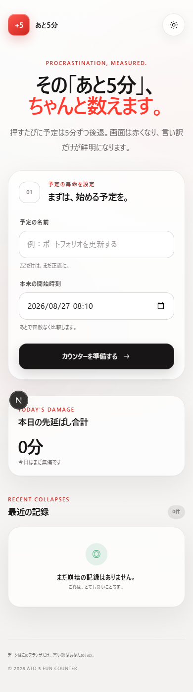
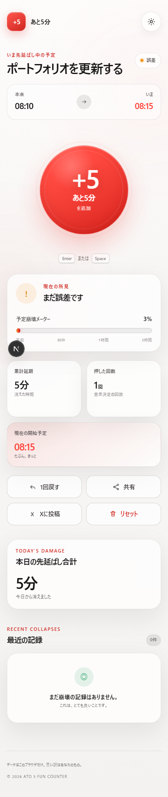
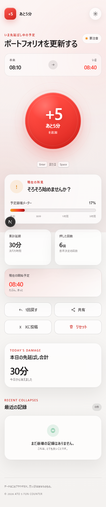
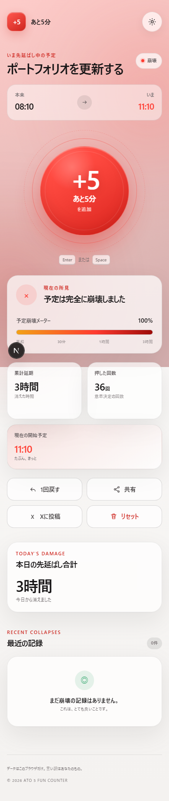
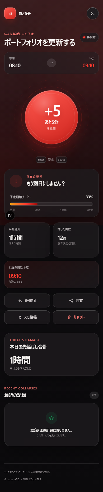

# あと5分カウンター

「あと5分」を押した回数と、少しずつ崩壊していく予定を可視化する、くだらないけれど使いたくなる先延ばしカウンターです。

[公開アプリ][app-url] ・ [GitHub リポジトリ][repo-url]

## 概要

予定名と本来の開始時刻を設定したら、あとは中央の「あと5分」ボタンを押すだけ。開始予定時刻が5分ずつ後ろへずれ、累計延期時間・押した回数・予定崩壊メーターが更新されます。延期するほど画面は赤くなり、励ましもだんだん諦めへ変わります。

## 主な機能

- 先延ばしする予定名と本来の開始時刻を設定
- 「あと5分」ボタンで予定を5分ずつ延期
- 現在の開始予定時刻、累計延期時間、押した回数をリアルタイム表示
- 延期時間に応じたメッセージと予定崩壊メーター
  - 5分: 「まだ誤差です」
  - 30分: 「そろそろ始めませんか？」
  - 60分: 「もう別日にしません？」
  - 180分: 「予定は完全に崩壊しました」
- 延期を1回戻す機能とリセット機能
- 履歴と本日の先延ばし合計をブラウザに保存
- Web Share API / Xへの共有と、非対応環境でのクリップボードコピー
- ライト・ダークモード、キーボード操作、モーション軽減設定に対応
- ホーム画面へ追加できるPWA
- Vercel Analyticsによる匿名の利用イベント計測

## スクリーンショット

### 1. 初期画面



### 2. 5分延期した状態



### 3. 30分延期した状態



### 4. 予定崩壊状態



### 5. ダークモード



## 技術構成

- Next.js（App Router）
- React
- TypeScript
- Tailwind CSS
- Web Storage API（localStorage）
- Web Share API / Clipboard API
- Progressive Web App（Web App Manifest / Service Worker）
- Vercel / Vercel Analytics
- Playwright（公開アプリのE2E確認・スクリーンショット取得）

有料APIや外部データベースは使用していません。

## ローカルでの使い方

Node.js 20以降を用意し、次のコマンドを実行します。

```bash
git clone https://github.com/shunsoco-stack/ato-5fun-counter.git
cd ato-5fun-counter
npm ci
npm run dev
```

[http://localhost:3000](http://localhost:3000) をブラウザで開いてください。

## PWAとして使う

公開アプリを対応ブラウザで開き、ブラウザメニューの「ホーム画面に追加」または「アプリをインストール」を選択すると、通常のアプリに近い形で起動できます。インストール方法の表示はOSとブラウザによって異なります。

## プライバシー

入力した予定名、開始時刻、延期履歴は端末の `localStorage` にのみ保存され、サーバーには送信されません。共有操作を実行した場合だけ、ユーザーが選んだ共有先へ生成済みの文章を渡します。

Vercel Analyticsでは改善のため、延期ボタン、共有、リセットの操作イベントを匿名で計測します。予定名などの入力内容はイベントに含めません。リセットした予定は端末内の履歴へ移り、全データはブラウザのサイトデータ削除で消去できます。

## 品質確認

```bash
npm run lint
npm run typecheck
npm run build
```

## 公開先

- アプリ: [公開アプリを開く][app-url]
- ソースコード: [GitHubで見る][repo-url]

[app-url]: https://ato-5fun-counter.vercel.app
[repo-url]: https://github.com/shunsoco-stack/ato-5fun-counter
